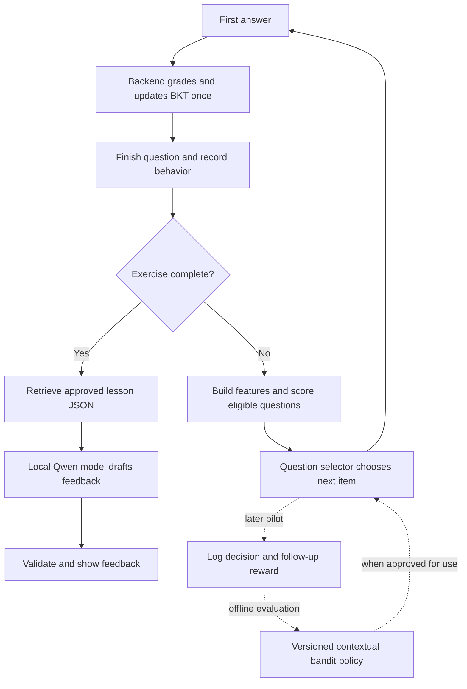

# Pathgen model and feedback architecture

Pathgen is a Grade 7 mathematics practice system. It uses Bayesian Knowledge Tracing (BKT) to estimate mastery, a trained agent to predict struggle on candidate questions, and retrieval-augmented generation (RAG) to explain what to review after an exercise. A contextual bandit is planned as a later improvement to the question-selection policy.

The BKT parameters and supervised agent are already fitted and evaluated on Junyi. Their integration into the application, the local feedback model, and the bandit pilot are planned work.

| Component | Artifact or source | Role in the application |
| --- | --- | --- |
| BKT | [bkt_parameters.json](../../roror/bkt_parameters.json) | Maintains one mastery estimate per student and modeled skill. |
| Supervised agent | [agent_model.pkl](../../roror/agent_model.pkl) | Predicts a probability of struggle for a candidate question. |
| Question selector | Backend policy | Filters the teacher’s question pool and chooses an eligible next question. A later bandit can improve this choice. |
| RAG feedback | Approved lesson JSON plus **Qwen2.5-0.5B-Instruct**, `Q4_K_M` GGUF | Retrieves relevant lesson material and writes a brief explanation at exercise completion. |

## 1. How an exercise runs

1. A student opens one of the six lesson HTML pages and launches an exercise in the shared `exercise.html?exerciseId=<id>` page. The backend loads the published exercise, its teacher-authored question pool, and its required question count.
2. The backend grades the first submission against the question’s answer key. It records the result and updates BKT **once** for that question’s primary skill. A retry or repeated request cannot count as a second mastery observation. For the pilot, offer hints after the first submission so the live first-attempt signal aligns more closely with the Junyi outcome definition.
3. When the question is complete, record attempts, hint use, duration, and the result. If questions remain, build features for each eligible unused candidate. The agent scores them and the backend selector chooses one from the current exercise pool. The student sees the selected question.
4. When the teacher’s question count is reached, finalize the exercise. The feedback service summarizes the recorded results, retrieves relevant lesson JSON, and sends a short prompt to the local language model. The shared exercise page displays the summary and a link back to its lesson.

The six pages cover integer foundations, addition, subtraction, multiplication, division, and expressions and applications. BKT tracks **ten individual skills** across those pages. Each question carries one primary skill ID. The admin designs the lessons and creates accounts. Teachers publish exercises and tag their questions, including cumulative review in Expressions and Applications.

## 2. BKT in the backend

The [fitting notebook](../../roror/bkt_fitting.ipynb) estimated four probabilities per modeled skill from the capped **263,813-row** fitting CSV: initial mastery, learning after an opportunity, guessing correctly while unmastered, and slipping while mastered. Forgetting was fixed at zero. On held-out Junyi validation students, mean log loss across skills was **0.4457**, compared with **0.4936** for a constant success rate per skill. [BKT fitting data and column definitions](bkt_fitting.md)

At startup, load the versioned parameter JSON. In the application database, store mastery by `(student_id, modeled_skill_id)`. A skill with no prior observations starts at its fitted initial mastery. On a first submission, update that probability using the answer result and apply the learning transition. Keep the observation and updated state together so that retrying a request does not apply the update again. An encounter without a submitted answer produces no first-answer observation. Record its completion status separately.

Keep the ten `modeled_skill_id` values consistent across the teacher question bank, BKT parameters, and agent features. The Junyi templates cover narrower tasks than some Pathgen objectives. For example, `INT_ABS_COMPARE` was fitted on absolute-value comparison. Check transfer before treating its estimate as evidence that a learner can also interpret and calculate absolute value independently. The opposites model’s guess parameter reached its fitting floor, so review that skill in the pilot as well.

## 3. How `agent_model.pkl` fits into Pathgen

The model is calibrated histogram gradient boosting. Its pickle includes the fitted preprocessing pipeline, one-hot skill encoding, training-fitted imputation and scaling, feature order, and saved classification threshold. Load the trusted project pickle once in the Python backend with the training scikit-learn version, **1.9.1**. Score a batch of eligible candidates with `predict_proba` and use the positive-class probability to rank them. The **0.315** cutoff is the threshold used for the reported binary flags. The selection policy can use the probabilities directly and should choose its challenge range separately.

### The 12 runtime features

| Feature | How Pathgen produces it |
| --- | --- |
| `candidate_skill_id` | Read the candidate’s teacher-assigned primary skill ID. Use the `modeled_skill_id` values shared with the BKT parameters. |
| `candidate_difficulty` | Supply the candidate’s difficulty on the same 0–1 scale used in training, where a higher value means more observed struggle on a comparable Junyi template. Establish a mapping from teacher tags or approved comparable items before relying on the score. |
| `last_correct` | Read the outcome of the most recent completed eligible encounter under the first-attempt and hint definition used for the agent. |
| `last_attempt_count` | Count submissions for that earlier encounter. |
| `last_hint_used` | Record whether the student used a hint in that earlier encounter. |
| `last_duration_sec` | Use valid measured duration from that earlier encounter. Treat invalid timing as missing. |
| `recent_correct_rate` | Share of successes over up to five earlier eligible encounters. |
| `recent_hint_rate` | Share with hints over the same prior window. |
| `recent_mean_attempts` | Mean submission count over the same prior window. |
| `recent_median_duration_sec` | Median valid duration over the same prior window. |
| `candidate_skill_prior_encounters` | Count completed eligible encounters in the candidate’s skill before the candidate is shown. |
| `candidate_skill_bkt_mastery` | Read the current mastery of the candidate’s skill, after applying earlier first-answer updates. |

The two CSV tracking fields, `user_id` and `candidate_time_done`, stay out of the model. The training target, `struggle_on_next_question`, comes from the candidate’s later outcome: a false recorded correctness flag, more than one attempt, or hint use. Live scoring happens before any of those candidate outcomes are known. [Agent feature schema](agent_training.md) · [CSV generator explanation](agent_csv_explain.md)

Use the most recent eligible encounters across the student’s skill history, including earlier exercises. For video questions, define how answer time is measured and check that it is comparable to the timing used in training. The training examples all had prior history. Use a stable teacher-defined starting choice for a new student or when the difficulty input cannot be mapped reliably. In a pilot, log provisional agent scores for comparison where the inputs are valid and keep the teacher-defined fallback available.

### What the evaluation showed

On **30,000 held-out Junyi examples**, the agent reached **80.11% accuracy**, **50.64% struggle recall**, and **0.4162 log loss**. BKT alone had **80.27% accuracy**, **40.48% struggle recall**, and **0.4342 log loss**. This supports testing the agent as a probability-based selector on Pathgen questions. Its live accuracy and effect on learning still need to be measured. [Full training and evaluation report](agent_traning_process.md)

## 4. Reinforcement learning later

Start with a **contextual bandit** at one decision point per exercise. A practical first candidate is **LinUCB with a bounded randomized exploration rule**. The supervised agent supplies predicted struggle as part of the context. The bandit learns which choice helps learners under similar conditions and can replace the initial selection rule after evaluation. It has its own policy version and leaves the supervised pickle and Junyi training files intact. [LinUCB and contextual bandits](https://arxiv.org/abs/1003.0146) · [Contextual bandits for adaptive curriculum](https://arxiv.org/abs/2207.14003)

| Bandit element | Pathgen design |
| --- | --- |
| Context | Candidate skill, current BKT mastery, recent attempts and hints, and predicted struggle for the eligible choices. |
| Action | Choose a difficulty level among teacher-approved questions of the target skill. Use a fixed rule to pick an unused question within that level. |
| Reward | First-attempt, unassisted success on a **comparable follow-up skill check**. Keep that check comparable across action choices. A missing follow-up is recorded as missing. |
| Decision log | Record the context, allowed actions, chosen action, selection probability, policy version, and linked follow-up outcome. |

Use the comparable check because rewarding success on whichever item was selected could favor the easiest questions. Start logging with the baseline selector. A later pilot needs some controlled variation among eligible choices, since a policy can learn little about options it never tries. Log the actual selection probability from the exploration rule. Evaluate the candidate policy before deploying it, and keep the baseline available. The number of learners and the coverage of alternative actions matter more than the number of calendar days. [Research on evaluation from logged decisions](https://arxiv.org/abs/1003.5956)

This pilot optimizes one decision with a defined follow-up. Q-learning would be a later option if Pathgen wants to optimize whole sequences for outcomes such as next-day retention, after collecting enough evidence about actions across multiple steps.

## 5. Local RAG feedback and the 500 MB model

Use **Qwen2.5-0.5B-Instruct in `Q4_K_M` GGUF** as the first model to test. The official file `qwen2.5-0.5b-instruct-q4_k_m.gguf` is listed at **491 MB**, within the approximately 500 MB model-file budget. That is the weight file size. The running process also uses memory for context and inference, so measure peak RAM and feedback latency on the target laptop. Serve the model locally with **llama.cpp**. [Official Qwen GGUF file](https://huggingface.co/Qwen/Qwen2.5-0.5B-Instruct-GGUF/blob/main/qwen2.5-0.5b-instruct-q4_k_m.gguf) · [llama.cpp server documentation](https://github.com/ggml-org/llama.cpp/blob/master/tools/server/README.md)

RAG means the backend retrieves approved lesson material before asking the model to write feedback. For the small lesson collection, store excerpts in versioned JSON indexed by `lesson_id` and `modeled_skill_id`. Each entry can contain a `snippet_id`, a short rule or explanation, a reviewed worked example, and a review link. An exercise involving multiple skills can retrieve excerpts for the skills that actually appeared. Direct ID lookup is sufficient for this collection.

After the exercise:

1. Build a small summary from server-graded results. Include skills practiced, first-attempt successes, and a priority skill to review based on actual errors or hint use.
2. Retrieve a few short, approved excerpts for that lesson and skill. Send only the relevant facts and excerpts to the local model. Use a short prompt that asks for one strength and one next step in student-friendly language.
3. Ask for structured JSON with fields such as `strength`, `next_step`, and `source_ids`. Check that required fields and source IDs are valid. Use teacher-approved math and server-calculated results as the source of truth. A valid JSON shape alone does not verify the content.
4. If generation fails, takes too long, or does not pass the feedback checks, show a short template assembled from the same exercise results and approved material. Review sample feedback for mathematical accuracy and usefulness before enabling the model for students.

Run generation **once per completed exercise**, with a saved result tied to that session. The app can show that feedback is being prepared while the local model runs. During the exercise, any hint comes from approved question content. The grading and next-question decision remain in the backend.

## 6. Where to put each part in the application

| Location | Responsibility |
| --- | --- |
| Lesson HTML and `exercise.html` | Display lesson content, present teacher-authored MCQs, send answers and hint requests, and display the next question or feedback. |
| Python backend | Verify access, grade from the answer key, persist attempts, update BKT, assemble agent features, and choose an eligible question. Load the BKT and agent artifacts once per service process. |
| Application database | Store published questions and skill tags, student mastery, ordered attempt history, exercise progress, final feedback, and versioned selection decisions. Use an encounter key to apply each BKT update once. |
| Versioned lesson JSON | Store the approved feedback excerpts and worked examples for retrieval. Keep IDs stable and review content changes before use. |
| Local llama.cpp process | Serve the Qwen model to the backend feedback service. Keep it off the per-question selection path. |
| Offline evaluation and training scripts | Train and version model artifacts, generate evaluation reports, and later fit or compare bandit policies using recorded Pathgen decisions. |

**Suggested build order:** get Integer Addition running end to end with the shared exercise page and BKT. Check that live feature calculations match the agent CSV. Run the agent on local questions in a pilot, verify the difficulty mapping, and enable its scores for selection once validated. Add the end-of-exercise JSON retrieval and feedback, then connect the remaining lesson pages to the same backend. Collect decision logs from launch and introduce the bandit after enough comparable follow-up data is available.
